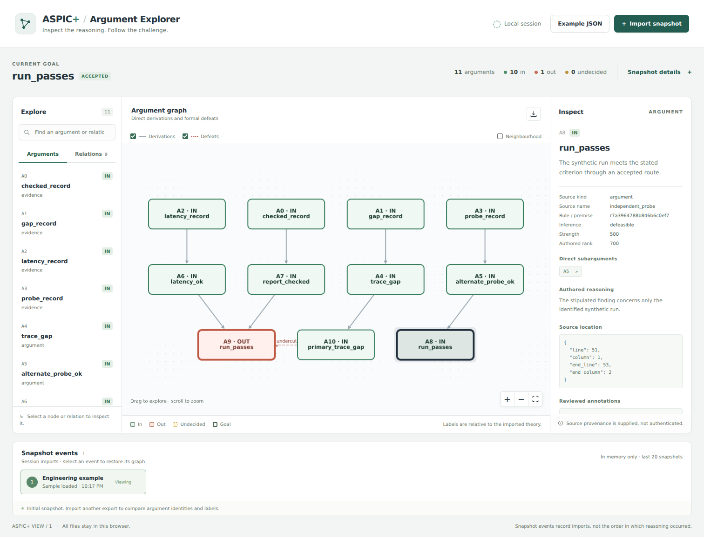

# ASPIC+ visualisation

A Vue 3 and TypeScript workbench for inspecting bounded ASPIC+ argument assessments. One graph shows **direct derivations and defeats together**. Select an argument or defeat to inspect its grounds, label, attacked subargument and supplied EAL source mapping.

The bundled API load-test example is synthetic. Its primary route is undercut by a trace-gap objection; an independent probe still supports the conclusion.



## Run locally

Requires Node.js 22.12 or later (Node 24 is used in CI).

```sh
npm ci
npm run dev -- --host 127.0.0.1
```

Open the printed local address. Files are parsed in the browser and are not uploaded. No backend, account, API key or external assets are required. After building, serve `dist/` using `npm run preview` or a static web server; opening `index.html` through `file://` is not supported.

## Bring an EAL assessment

Use the companion implementation in [EAL PR #29](https://github.com/emmett08/earl/pull/29):

```sh
# In an EAL workspace, save the full compile-aspic response as result.json.
eal --workspace . export-aspic result.json --output view.json
```

Or generate the maintained synthetic example from the EAL repository:

```sh
python examples/api-load-test/aspic_compiled_demo.py --export-view /tmp/view.json
```

Import `view.json` in this app. Explicit formal theories can use the same EAL exporter with JSON containing `theory` and `formal`. The app consumes the versioned [`aspic-view/1` JSON contract](schema/aspic-view.schema.json), not EAL source text.

- Solid derivation edges connect an immediate subargument to the argument using it. Reused evidence remains one node.
- Dashed defeat edges connect attacker to defeated argument. The inspector identifies the exact attacked subargument and whether the defeat undermines, rebuts or undercuts.
- `in`, `out` and `undecided` are grounded labels, not truth values. A strict inference may still depend on fallible premises.
- Source text, rationale, declaration location, observation metadata and review references remain inspectable. Missing observations appear separately and never become negative premises.
- Search and the argument list provide keyboard access to graph selection. Relation filters and neighbourhood focus make hidden graph content explicit.
- Import successive snapshots to record session events and compare added, removed and relabelled derivations. Restoring an event restores its graph. Import order is not evidence chronology or a solver execution trace; differing source or assessment identities remain visible.

## Trust boundary

EAL recomputes the bounded formal theory and requires exact agreement with the supplied solver result before exporting. It checks supplied source-map structure but does not authenticate observations or establish correspondence between English statements and formal atoms.

The browser validates the import contract, resource bounds, graph references, derivation closure and grounded labels against the imported defeat graph. It does **not** construct an ASPIC+ theory, check that every warranted defeat was exported, recollect evidence, or authenticate the exporter. An export's validation field is a supplied assertion, not a signature. Files are bounded to 4 MiB, 128 arguments and 4,096 defeat witnesses.

This is an inspection app, not a replacement for the solver or EAL's default evaluator. PyArg is an inspiration for interactive argument inspection; this app does not claim all of PyArg's theory editing, preference policies or extension semantics.

## Development

```sh
npm run typecheck
npm test
npm run build
npx playwright install chromium
npm run test:browser
```

Dependencies are pinned and `package-lock.json` is committed. See [architecture](docs/architecture.md) for the module boundary and comparison rules. Vue text interpolation and Cytoscape labels render imported values as text; imported HTML is never executed.
