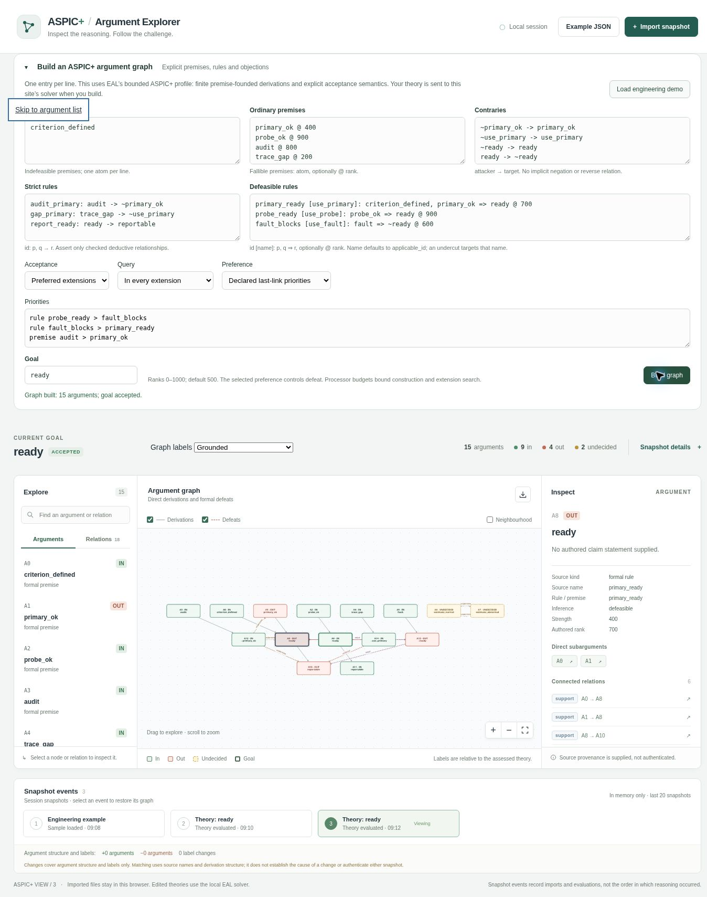
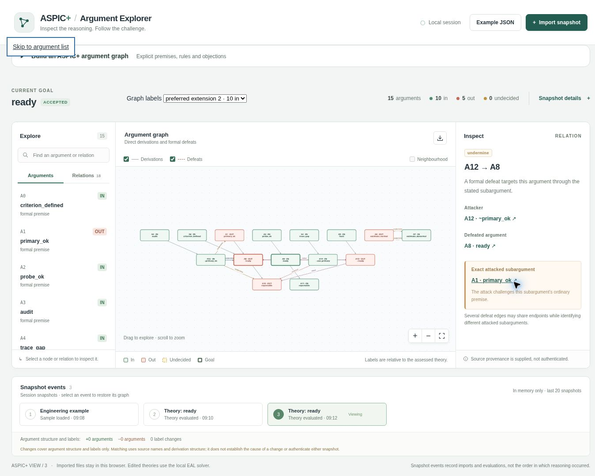
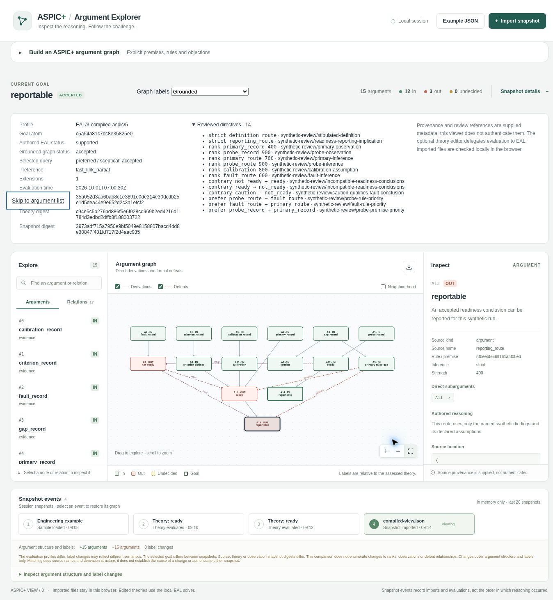

# ASPIC+ keyword example verification

The companion [EAL examples PR](https://github.com/emmett08/earl/pull/51) supplies an authored compiler example and an explicit typed theory for a fixed synthetic controller run. The producer uses package `3.1.0`, method `argumentation/aspic/2`, implementation `eal-aspic-finite-5` and export `aspic-view/3`.

The cloud browser imported both retained exports and rebuilt the explicit theory through the live EAL solver. The editor preserves the declared applicability atoms `use_primary`, `use_probe` and `use_fault` through the new `id [name]: premises => conclusion @ rank` notation. The priorities field occupies a complete row so its declared rule and premise comparisons remain readable.

| Browser check | Observed result |
| --- | --- |
| Import authored compilation | `reportable` accepted; 15 arguments, 6 defeats, 12 grounded `in`, 3 `out`; all 14 reviewed directives displayed. |
| Import explicit theory | `ready` accepted under preferred sceptical semantics; 15 arguments, 10 defeats, 9 grounded `in`, 4 `out`, 2 `undecided`. |
| Rebuild exact explicit theory | Named applicability atoms, negative literals, strict and defeasible rules, both premise kinds and declared priorities entered; live solver returned the same 15 arguments and accepted goal. |
| Select both preferred extensions | Each extension has 10 `in`, 5 `out`, 0 `undecided`; the tied estimate premises exchange labels. |
| Inspect undercut | `A14` attacks primary readiness `A8` through its defeasible rule; exact attacked subargument is `A8`. |
| Inspect undermining | `A12` defeats readiness `A8` through ordinary premise `A1`, preserving the distinction between the defeated argument and attacked subargument. |

The cloud captures below retain the complete page, including source metadata, graph, inspector and session events. The fields contain synthetic values. Imported provenance and reviewed references remain supplied assertions.

Type checking, all 61 unit tests, the production build, 12 automated browser tests and six Python process-bridge tests passed. The editor equality test reconstructs the complete input theory; the generated fixtures also check exact attacked subarguments, propagated defeats and the separation of grounded labels from extension queries. [Fixture instructions](../tests/fixtures/README.md) reproduce the inputs and exports.

The checks establish coverage of the implemented finite ASPIC+ contract. Its three preference selectors are `minimum_rank`, `last_link_rank` and `last_link_partial`; the producer documentation specifies their semantics. These tests supply no claim about physical controller behaviour or other ASPIC+ instantiations.
