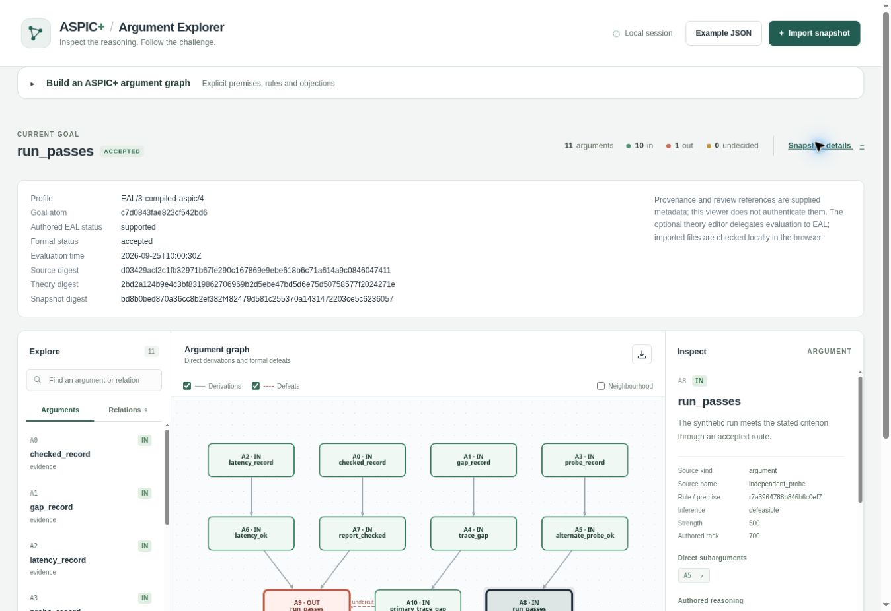
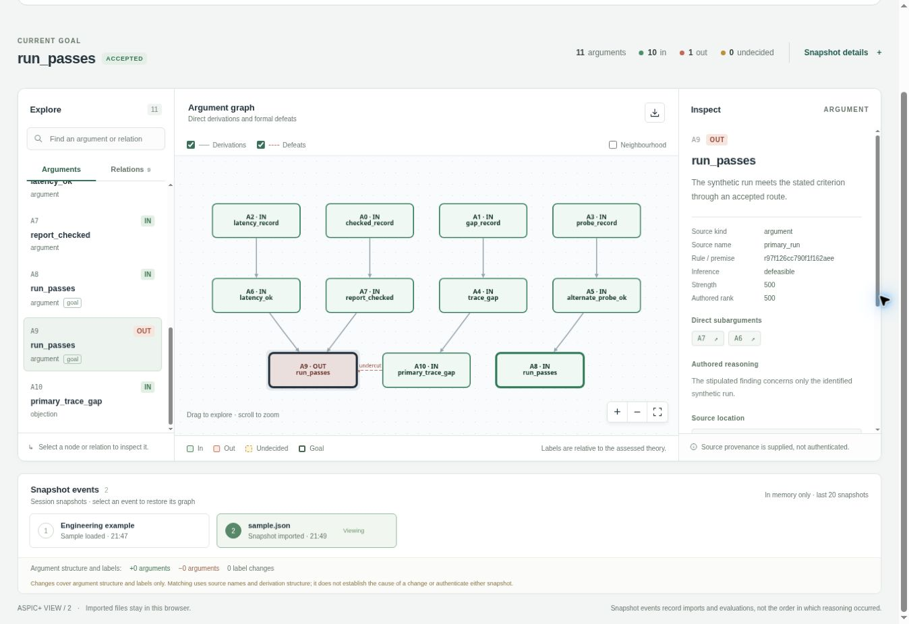

# EAL/3 browser verification

The maintained sample was regenerated using the EAL/3 compiler and exporter:

```sh
python examples/api-load-test/aspic_compiled_demo.py --export-view PATH_TO_APP/src/domain/sample.json
```

The cloud browser opened the development preview and imported that exact `sample.json`
through the file chooser. It retained 11 arguments, 10 `in`, one `out`, zero undecided,
and the accepted `run_passes` goal. Reimporting the bundled sample recorded a second
snapshot event with zero structural or label changes.

Snapshot metadata displays `EAL/3-compiled-aspic/4`. The inspector shows the
independent route's authored rank 700 and supplied review reference. Selecting
`primary_run` shows its two direct subarguments and the objection's undercut; the
independent probe route remains accepted. The footer reports `aspic-view/2`.





Type checking, all 46 unit tests, the production build, seven Playwright browser
tests and six Python bridge tests passed. Browser tests cover mobile layout,
keyboard navigation, reviewed annotations, malformed imports and unavailable
evidence. The bridge requires package 3.0.0 and the pinned ASPIC implementation.
The consumer schema remains byte-identical to the EAL producer's `aspic-view/2`
schema. Screenshots show a synthetic example; provenance and review references
are supplied metadata.
